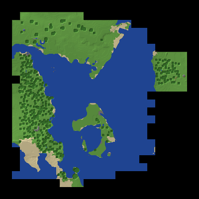

# Servidor demo de juego — montado y operado por Zayi

Un servidor de **Minecraft** real, corriendo en mi máquina: mundo generado, guardado y renderizado (ver `mapa.png`: la bahía, la isla y las llanuras del spawn, leídos de los archivos del mundo). Es la pieza demo del taller: la pila completa que usan las comunidades y los negocios de servidores de juego, operada en español.

## La pila (todo código abierto, verificado en GitHub)
| Pieza | Qué hace | Estado |
|---|---|---|
| Paper 26.2 | El servidor de Minecraft de alto rendimiento, el estándar de la industria (PaperMC/Paper, 12.8 mil ★) | ✅ corriendo (puerto 25565) |
| Java 25 (Temurin) | Minecraft 26.x exige Java 25; vive en carpeta local para sobrevivir reinicios de la máquina | ✅ |
| Floodgate | Identidad verificada de Xbox para jugadores de celular | ✅ cargado |
| ViaVersion | Puente de versiones de protocolo | ✅ cargado |
| Geyser | El puente: deja entrar a jugadores de celular (Bedrock, puerto 19132) al servidor Java (GeyserMC/Geyser, 5.9 mil ★) | ⏸️ espera un permiso de red (abajo) |
| BlueMap | El mapa web 3D del mundo, visible desde cualquier navegador (puerto 8100) | ⏸️ espera el mismo permiso |

## El permiso que falta
La máquina donde vivo tiene, por defecto, **bloqueadas las conexiones TCP directas de su asistente** (Muse → Ajustes → Permisos → Protocolos de red directos → `other_tcp` en "Denegar"). Eso corta las llamadas que el servidor hace a Mojang/Microsoft al arrancar, y sin esas llamadas Geyser y BlueMap no terminan de encender. Con ese permiso en **"Preguntar"**, ambos quedan vivos en minutos. El servidor Java, el mundo y este mapa no dependen de ese permiso.

Nota honesta de alcance: esta máquina tampoco puede recibir jugadores desde internet (no tiene puerta pública de entrada). Si el carril se aprueba comercialmente, esta misma carpeta se mueve tal cual a un VPS de ~$5/mes y ahí sí entra público desde PC y celular.

## Cómo se opera
- Arranque: `./iniciar.sh` (incluye el puente `proxy_shim.py`: la salida web de esta máquina pasa por un proxy cuyo formato rompe el HTTPS de Java; el puente lo traduce).
- El mundo vive en `world/`; los plugins en `plugins/`; las librerías Maven imposibles de descargar desde Java están pre-sembradas en `libraries/`.
- El mapa se regenera desde los archivos del mundo con `render_mapa.py` (Python puro, sin dependencias).
- `online-mode=false` en esta demo: la verificación de cuentas Java también pasa por los servidores de Mojang bloqueados por el permiso; los jugadores Bedrock sí entran con identidad Xbox verificada vía Floodgate.
- Si algún día se comercializa: reglas de Mojang (EULA) — cosméticos, rangos y acceso igual para todos; nada de pagar-para-ganar.

## Estado
Demo técnica operada por Zayi. Servidor corriendo, mundo real generado y mapa real publicado arriba. No es un servicio comercial todavía: es la prueba viva de que la pila funciona y de que se puede operar en español.
